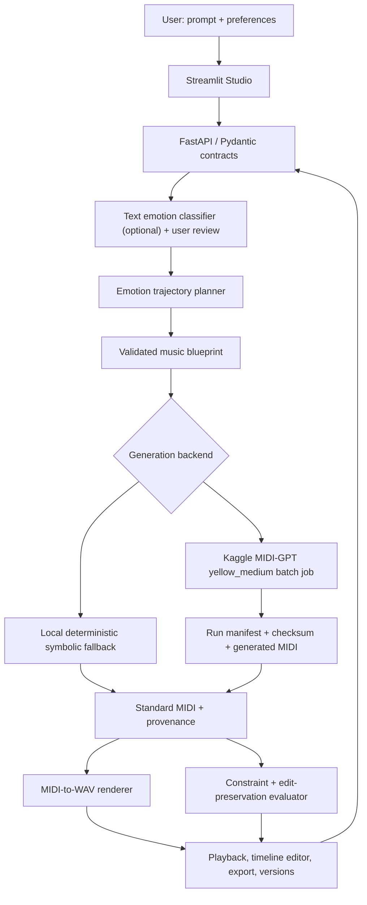

# 🎼 Whispers of the Wires — Music Composition Studio

**Mentor review candidate: `mentor-readiness-dashboard`.** The original
eight-week proposal and the compressed six-week PDF have been audited.
This branch adds a blue album-style dashboard, composition controls, saved
library, favorites, playlists and dataset checks to the original six-phase
codebase. The CPU pipeline is testable; actual pretrained Kaggle execution,
fine-tuning and human listening claims are **not verified**.

## Quick start (Python 3.11)
```bash
git checkout mentor-readiness-dashboard
python -m venv .venv
# Activate .venv for your operating system
pip install -e ".[dev,studio]"
pytest tests/phase_v2 -q
python -m uvicorn wow.api:app --host 127.0.0.1 --port 8000
# Second terminal:
streamlit run studio_v2.py
```

Mentor documentation: [Requirements audit](docs/REQUIREMENTS_TRACEABILITY.md),
[Demo script](docs/MENTOR_DEMO.md), [Report](docs/FINAL_PROJECT_REPORT.md),
[Model decisions](docs/MODEL_DECISIONS.md).

---

# 🎵 Whispers of the Wires
### Emotion-Trajectory-Guided, Controllable AI Music Composition Studio

> **Status: Six phases of baseline application code are pushed for testing. The V2 CPU pipeline and CI smoke tests run on GitHub Actions; Kaggle MIDI-GPT execution, neural-audio quality, human listening studies and Windows browser acceptance remain unverified.**
> This repository currently contains an earlier Streamlit/MusicGen prototype on `main`.
> The `original` branch is the agreed **design baseline** for a new phased implementation.
> Phases describe both implemented baseline behavior and future integration goals. Only successful CI and real GPU runs constitute execution evidence.

**Project goal:** Given a short story, mood, or context, propose a *time-varying emotional trajectory*, translate it into a structured musical blueprint, generate editable multitrack instrumental MIDI, render audio, and allow localized musical edits while protecting untouched events. Evaluate both musical constraints and perceived emotion through reproducible tests and listener feedback.

**Team & constraints:** one student developer; local CPU; **Kaggle cloud GPU available intermittently**, not a continuously available API; development-first, noncommercial academic prototype; initial English-only instrumental generation.

## Why this project is different
A text-to-audio prompt wrapper alone is not a research contribution. This project investigates:
1. **Explicit emotional trajectories:** e.g. nervous → confident → relieved, with independently editable bar regions.
2. **Constrained symbolic music plans:** key, tempo, instrument roles, section boundaries and reproducible note events.
3. **Selective bar-level edits:** edit harmony in bars 5–8 without changing melody or other locked events, verified from MIDI data.
4. **Transparent evaluation:** structural checks, timing/density measures, candidate comparisons and *human* ratings of emotion (not invented automatic emotion accuracy).

### Example
Prompt: “Compose music for an anxious student before an exam, then confidence, then relief.”
Result: a proposed 12-bar composition plan with three contiguous 4-bar sections at 96 BPM in 4/4 (30 seconds), a melody/harmony/bass/drums arrangement, output MIDI and rendered WAV, and the ability to revise one section without rewriting others. Mood/music associations are **heuristics to validate**, not universal laws.

## Design: end-to-end flow


**Fundamental distinction:** MIDI tracks are editable symbolic parts; neural audio generators produce audio that generally cannot guarantee exact note-level preservation. An ACE-Step neural audio pathway is an **optional later extension**, not the MVP dependency.

## Initial model and technology decisions

| Responsibility | Planned implementation | Runtime/qualification |
|---|---|---|
| Text emotion classifier | `j-hartmann/emotion-english-distilroberta-base` | Optional local CPU NLP signal; emotion categories are not guaranteed musical-emotion labels |
| Emotion-to-music plan | `RuleBasedTrajectoryPlannerV1` + user review | Local CPU, explainable and deterministic baseline |
| Primary AI symbolic generator | MIDI-GPT `yellow_medium` (Metacreation) | Kaggle notebook on available GPU; has shorter 4/8-bar contexts, use segment assembly |
| Always-available fallback | `RuleBasedComposerV1` | Local CPU; provenance must show fallback |
| MIDI rendering | pretty_midi + FluidSynth and properly licensed SoundFont | Local CPU; WAV exported when synthesis assets available |
| Neural audio enhancement | ACE-Step 1.5 `acestep-v15-turbo` | Optional extension after GPU/memory/license feasibility test |
| API + schema | Python 3.11, FastAPI, Pydantic v2 | Local machine |
| App UI | Streamlit | Reuse elements of existing UI where safe |
| Persistence | SQLite + checksummed filesystem artifacts | No Redis or always-on infrastructure required |
| Verification | pytest, Ruff, optional mypy, GitHub Actions | No model-download requirement in CI |

**Licenses:** repository MIT covers only code owned here. Checkpoint, training music, SoundFont and other third-party licenses apply **separately**. Published MIDI-GPT weights are labeled CC BY-NC 4.0; do not assume unrestricted commercial rights. Never upload copyrighted music without permission. No guaranteed copyright-free output claims.

## System boundaries and contracts
All exchanges use versioned Pydantic/JSON contracts; reject malformed requests explicitly.

### Canonical music blueprint (illustrative)
```json
{
  "schema_version":"1.0","request_id":"demo-001",
  "prompt":"Nervous then confident then relieved",
  "language":"en","mode":"instrumental",
  "tempo_bpm":96,"time_signature":{"numerator":4,"denominator":4},
  "key":"C_major","total_bars":12,
  "sections":[
    {"id":"A","start_bar":0,"bar_count":4,"mood":"nervous","valence":-0.6,"arousal":0.7},
    {"id":"B","start_bar":4,"bar_count":4,"mood":"confident","valence":0.5,"arousal":0.8},
    {"id":"C","start_bar":8,"bar_count":4,"mood":"relieved","valence":0.7,"arousal":0.3}
  ],
  "tracks":[
    {"id":"melody","program":0},
    {"id":"harmony","program":48},
    {"id":"bass","program":32},
    {"id":"drums","is_drum":true}
  ],
  "generation":{"provider":"midigpt","checkpoint":"yellow_medium","seed":42,"max_candidates":2}
}
```
*Bars are zero-indexed; `end_bar_exclusive` is exclusive; initial scope 4/4 and 60–160 BPM; all sections contiguous, bounded, non-overlapping. Valence/arousal values are illustrative targets.*

### Module contracts
| Module | In | Out | Failure behavior |
|---|---|---|---|
| EmotionAnalyzer | prompt, language | label probabilities + review flags | no invented confidence |
| TrajectoryPlanner | prompt analysis, target bars | ordered sections | reject ambiguous/invalid layout |
| BlueprintBuilder | sections and preferences | validated MusicBlueprint | typed validation error |
| SymbolicComposer | blueprint, provider, seed | MIDI + provenance | explicit error/fallback; never relabel fallback AI |
| CloudJobAdapter | manifest | Kaggle run reference/status | timeout/unavailable must remain visible |
| ArtifactImporter | generated files/checksums | verified project artifacts | quarantine mismatched files |
| MusicRenderer | MIDI + synth config | WAV | reject missing synth dependencies |
| SelectiveEditor | version + track/region | new version + MIDI | reject changed locked events |
| Evaluator | MIDI, WAV, plan | metrics + warnings | unsupported metric marked unavailable |
| VersionRepository | versioned outputs | immutable history | never silently overwrite |

### API targets
`GET /health`, `POST /api/v1/analyze`, `POST /api/v1/blueprints`, `POST /api/v1/jobs`, `GET /api/v1/jobs/{id}`, `POST /api/v1/jobs/{id}/import`, `GET /api/v1/compositions/{id}`, `POST /api/v1/compositions/{id}/edits`, `POST /api/v1/evaluations`. Exact availability is **phase-dependent**.

A cloud run produces `manifest.json`, `composition.mid`, `generation_metrics.json`, `run_environment.json`, `generation.log`. Importer must validate request ID, schema, model identity, checksums and output integrity. Kaggle is **batch execution only**; no promise of free unlimited real-time inference.

## Phase-by-phase branches and delivery gates
**Branch policy:** `original` = documented design baseline; each `phase-0N-*` is built from the previous accepted phase (not from stale `main`); changes are pushed to their own branch for human testing. The maintainer decides whether/when to merge PRs into `original`. No auto-merge, no force-push of existing work.

| Phase / planned branch | Deliverables | Minimum acceptance gate |
|---|---|---|
| **1** `phase-01-foundation` | Contracts, API health, deterministic local MIDI composer, automated tests, Kaggle smoke-test notebook, artifact schema | valid 4-track MIDI and passing tests; actual Kaggle proof only after remote run |
| **2** `phase-02-emotion` | English mood parser, trajectory editing/review, structured music blueprint | deterministic valid, contiguous 3-section trajectory; edge cases tested |
| **3** `phase-03-generation` | 4/8-bar generation adapter, multitrack orchestration, renderer, artifact import | rendered MIDI/WAV; real MIDI-GPT result after Kaggle test |
| **4** `phase-04-studio` | Streamlit create/plan/listen/export, selective MIDI edit, version history | locked events unchanged and undo works |
| **5** `phase-05-evaluation` | theory/rhythm/signal metrics, test protocol, listener-rating storage, baseline comparisons | reproducible measured metrics, no unsupported accuracy claims |
| **6** `phase-06-hardening` | robustness, validation, security, docs, optional neural-audio adapter behind feature flag | clean install/test, documented deployment limits and model terms |

**Important:** Individual phase branches contain code submitted for verification; no phase is automatically accepted or merged. Check PR statuses and user-side results. Check the branch, PR checks and `docs/PHASE_TRACKER.md` on each phase for actual completion evidence.

### MVP success criteria
- A user can input an English context and review/edit three emotional sections.
- Valid twelve-bar four-track MIDI can be generated via the fallback and, after Kaggle verification, MIDI-GPT; provenance is visible.
- A MIDI file can be rendered as WAV and played.
- Editing a selected track/bar range creates a new version **without changing locked note events** outside the selection.
- Artifacts survive an application restart; invalid/corrupted imports are rejected.
- Unit/integration tests pass in CI without GPU, and reproducible Kaggle evidence is logged separately.
- Emotion alignment is assessed with blinded human feedback. Computational note density and velocities are *proxies*, not emotion accuracy.

## Development and testing
The default branch `main` currently hosts a *legacy* Streamlit/MusicGen prototype. Do not confuse existing commands or marketing statements with the new phased pipeline. To try that legacy app before merging new branches:
```bash
git clone https://github.com/shanmukhdatta/whispers_of_the_wires.git
cd whispers_of_the_wires
python -m venv .venv
# Activate .venv for your OS
pip install -r requirements.txt
streamlit run app/main.py
```
New branches must update this section with their **actually tested** commands and provide instructions for CPU-only tests, Kaggle notebook setup and evidence collection. Avoid committing API credentials, model weights, datasets and generated audio.

## Research plan
Compare (a) single global-mood baseline, (b) explicit trajectory without selective editing, (c) trajectory plus constrained editing. Match generator and budget, report held-out prompts, listener ratings with uncertainty, segment-level perceived mood, event preservation, latency and failure rates. Do not assert quality gains until measured.

## Reference materials
The proposal is based on three project files: *AI-Based Music Composition System Document*, *AI-Based Music Composition 8-week Plan*, and *AI-Based Music App Knowledge Reference Guide*. These define the original mood/context purpose, Streamlit delivery, research/model exploration, evaluation and testing requirements. Technical decisions above are an implementation-oriented revision, not claims that the older documents were already implemented.

Research links: [MIDI-GPT](https://github.com/metacreation-lab/MIDI-GPT), [ACE-Step](https://github.com/ace-step/ACE-Step), [pretty_midi](https://github.com/craffel/pretty-midi), [Kaggle API](https://github.com/Kaggle/kaggle-api).

## Credits and terms
This repository's code carries its own `LICENSE`; pretrained checkpoints and music assets carry separate conditions. Built as an academic, human-in-the-loop creative tool.

## New V2 local application (on later phase branches)
These steps apply after checking out `phase-06-hardening` or an accepted branch containing Phases 1–6. They are **not** instructions for unmodified `main`:

1. Use Python 3.11, create a fresh virtual environment.
2. `python -m pip install -e ".[dev,studio]"`
3. `python -m pytest tests/phase_v2 -q`
4. `python -m uvicorn wow.api:app --host 127.0.0.1 --port 8000`
5. In a second terminal: `streamlit run studio_v2.py`
6. Create, review, generate with `rule_based`, listen and edit.
7. For true pretrained symbolic generation, follow `notebooks/kaggle/README.md` and
   `docs/CLOUD_WORKFLOW.md`; import outputs after a successful GPU run.

The basic WAV renderer uses simple waveforms and sounds synthetic; it is not a
high-quality neural audio output. User-rated emotion accuracy is not known.

## All-phases implementation status (V2)

Implemented in the later code branches:
- User-editable emotion trajectory table: modify section mood, valence and arousal before generation.
- Deterministic four-track symbolic baseline and synthesis WAV preview.
- Kaggle MIDI-GPT batch-generation script plus a private-kernel CLI for preparing, pushing, checking and importing a cloud job.
- Versioned MIDI editing with preserved locked note events; WAV/MIDI download and complete project ZIP export.
- Objective MIDI/audio evaluation, per-section human rating storage, descriptive preference recommendations and cloud-job cancellation.
- SQLite-backed local job storage, checksummed import and export manifests, CPU unit/integration tests and GitHub Actions.

**The trained MIDI-GPT weights are third-party, not trained by this project.**
The Kaggle generation runner is an unverified integration candidate until run in the
user's account. The built-in synthesizer uses simple waveforms. A commercial
streaming generator, vocals, text-to-professional-audio quality, continuous
automatic Kaggle hosting, and ACE-Step inference are **not implemented**.

### Kaggle job tool

Install optional cloud dependencies with `pip install -e ".[dev,studio,cloud]"`.
Sign in to Kaggle CLI using your private credentials (never commit them).
After choosing `midigpt` in the Studio and receiving a pending job ID:

```bash
python scripts/kaggle_job.py prepare JOB_ID --username YOUR_KAGGLE_USERNAME
python scripts/kaggle_job.py push JOB_ID
python scripts/kaggle_job.py status YOUR_KAGGLE_USERNAME/wow-music-JOBPREFIX
python scripts/kaggle_job.py collect JOB_ID YOUR_KAGGLE_USERNAME/wow-music-JOBPREFIX
```

The private kernel slug and bundle directory are printed by the prepare/push steps.
Wait until the Kaggle job completes before collecting. See `docs/CLOUD_WORKFLOW.md`.

### Export and personalization

The Studio supports downloadable WAV, MIDI and a ZIP archive with blueprint
and integrity manifest. Feedback is stored locally; recommendations require at
least three ratings for a given mood and are explicitly descriptive, not learned
musical emotion mappings.

### Validation versus completion

The implementation is pushed **before user testing as requested**. Do not merge
it into a public production default branch until actual GPU execution, Windows UI
testing, music listening and security checks are completed. No model-quality
benchmark scores are claimed.
